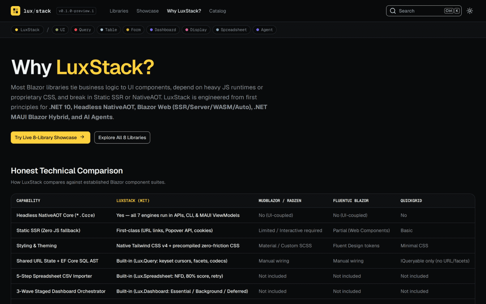

# LuxStack (`lux.stack`)

[](https://github.com/luxstack/lux.stack/actions/workflows/ci.yml) [](https://www.nuget.org/packages/Lux.Stack) [](https://dotnet.microsoft.com/) [](https://luxstack.dev/why) [](./LICENSE)

> **Modular, headless-first Blazor & .NET 10 component ecosystem — engineered for Static SSR, Interactive Server, WebAssembly, .NET MAUI Blazor Hybrid, and NativeAOT.**



**LuxStack** is an ecosystem of **8 independent, composable libraries** united under one architecture:

- **`Lux.<Product>.Core`** — 100% headless C#, zero UI dependencies, `<IsAotCompatible>true</IsAotCompatible>`, `<IsTrimmable>true</IsTrimmable>`.
- **`Lux.<Product>`** — Multiplatform Blazor UI (`Lx*` components, `--lux-*` CSS tokens, Tailwind v4) for Blazor Web (SSR, Server, WASM, Auto) and `.NET MAUI Blazor Hybrid`.

---

## Quick Start

### Option A — Full Ecosystem (`Lux.Stack`)
```bash
dotnet add package Lux.Stack --prerelease
```
```csharp
builder.Services.AddLuxStack();
```

### Option B — Headless NativeAOT Engines Only (`Lux.Stack.Core`)
```bash
dotnet add package Lux.Stack.Core --prerelease
```

### Option C — Scaffold a Ready-to-Run Project (`Lux.Templates`)
```bash
dotnet new install Lux.Templates::0.1.0-preview.1
dotnet new lux-saas -n MySaaSApp          # Blazor Web App wired to Lux.Stack + precompiled CSS
dotnet new lux-admin -n MyBackoffice      # Admin Backoffice (Dashboard + Table + Form + Preview)
dotnet new lux-headless -n MyAotWorker    # NativeAOT Console engine wired to Lux.Stack.Core
dotnet new lux-maui -n MyMobileApp        # .NET MAUI Blazor Hybrid (iOS, Android, macOS, Windows)
```

### Zero-Friction CSS (No Node or Tailwind Required)
Every UI package ships a precompiled, minified stylesheet in `wwwroot/`:
```html
<link rel="stylesheet" href="_content/Lux.UI/lux.preflight.css" />
<link rel="stylesheet" href="_content/Lux.UI/lux.css" />
<link rel="stylesheet" href="_content/Lux.Stack/lux-stack.css" />
<!-- Or individually: _content/Lux.Table/lux-table.css, _content/Lux.Form/lux-form.css, etc. -->
```

### Measured Benchmarks (`.NET 10` Release — [Full Report](./docs/benchmarks.md))
| Scenario | Median | Footprint |
| :--- | ---: | ---: |
| `Lux.Query` InMemory — **100,000 rows** (Filter + Sort + 5 Facets) | **16.61 ms** | 239.5 KB (`Lux.Query.Core.dll`) |
| `Lux.Spreadsheet` — **10,000 CSV rows** (Parse + NFD + Rules + Dedup) | **22.99 ms** | 92.5 KB (`Lux.Spreadsheet.Core.dll`) |
| `Lux.Table` — **2,020-node Tree** (`BuildTree`, 3 levels) | **0.68 ms** | 15.0 KB (`Lux.Table.Core.dll`) |
| `Lux.Display` — **RFC 4180 CSV Preview** (10k input, 1k cap) | **0.30 ms** | 33.5 KB (`Lux.Display.Core.dll`) |
| **All 8 Headless Core Engines Combined** | — | **536.0 KB** (pre-trim / pre-brotli) |

### Option D — AI Assistant Integration (`lux-stack-mcp`)
```bash
dotnet tool install --global Lux.Stack.Mcp --prerelease
lux-stack-mcp
```

---

## Ecosystem Directory

| Library | Headless Core (NativeAOT) | Blazor & MAUI UI | Key Primitives & Components | Live Docs |
| :--- | :--- | :--- | :--- | :--- |
| **Lux.UI** | `Lux.UI.Build.Tasks` | `Lux.UI`, `Lux.UI.Server`, `Lux.UI.Images` | 100+ `Lx*` components, Tailwind v4 tokens, icons, fonts, 12 locales | `/ui` |
| **Lux.Query** | `Lux.Query.Core` | `Lux.Query`, `Lux.Query.EntityFrameworkCore` | `DataListSchema`, 13 filter operators, facets, keyset cursors, `QueryState`, EF Core SQL | `/query/docs` |
| **Lux.Table** | `Lux.Table.Core` | `Lux.Table` | `LxDataList`, `LxDataListTable`, `LxDataListGrid`, grouping, trees, summaries, saved views | `/table/docs` |
| **Lux.Form** | `Lux.Form.Core` | `Lux.Form` | `FormSchema`, `FormController`, `FormService`, `LxFormEngine`, `LxFormPage`, `LxFormProvider` | `/form/docs` |
| **Lux.Dashboard** | `Lux.Dashboard.Core` | `Lux.Dashboard` | `DashboardController` (3-wave staging), `DashboardFormat` CSV, `LxDashboardPage`, KPIs & charts | `/dashboard/docs` |
| **Lux.Display** | `Lux.Display.Core` | `Lux.Display` | 19-kind `LxDisplay`, `LxAudioPlayer`, `LxVideoPlayer`, `FilePreviewService`, `LxFilePreviewProvider` | `/display/docs` |
| **Lux.Spreadsheet** | `Lux.Spreadsheet.Core` | `Lux.Spreadsheet` | `SpreadsheetImporter` (NFD headers, 80% suggestions, duplicates/upsert, batch retry), `LxSpreadsheetImport` | `/spreadsheet/docs` |
| **Lux.Agent** | `Lux.Agent.Core` | `Lux.Agent` | `AgentBridgeService` (snapshot/query/act/observe, secret redaction, `AllowPolicy`), `UndoStack<T>` | `/agent/docs` |

---

## Explore Live

- **Unified 8-Library Interactive Showcase** (`/showcase`) — Revenue Ops backoffice combining Dashboard, Query, Table, Form Drawer, Spreadsheet, File Preview, AI Agent Copilot, and Lux.UI.
- **Why LuxStack?** (`/why`) — Architecture & feature comparison vs traditional monolithic Blazor suites.
- **Documentation Hub** — [Getting Started](./docs/getting-started.md) · [Architecture](./docs/architecture.md) · [API Reference](./docs/api-reference.md) · [MAUI & NativeAOT](./docs/maui-and-aot.md)

---

## Building, Testing & Packing

```bash
dotnet build
dotnet test
dotnet pack -c Release
```

## License

MIT — see [LICENSE](./LICENSE).
